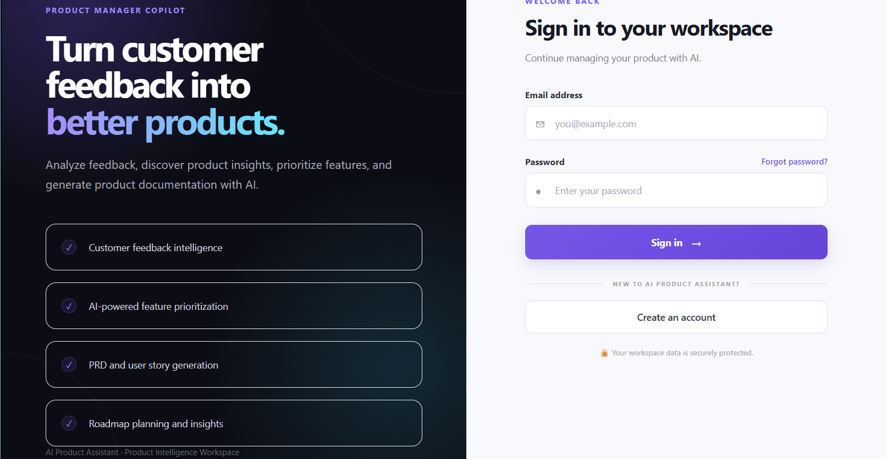
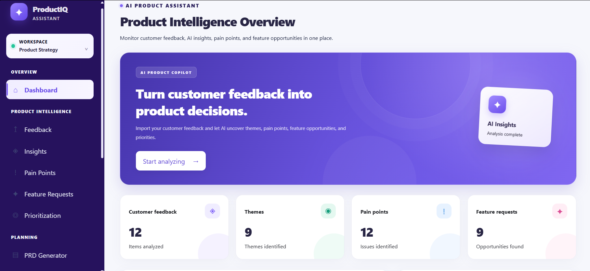
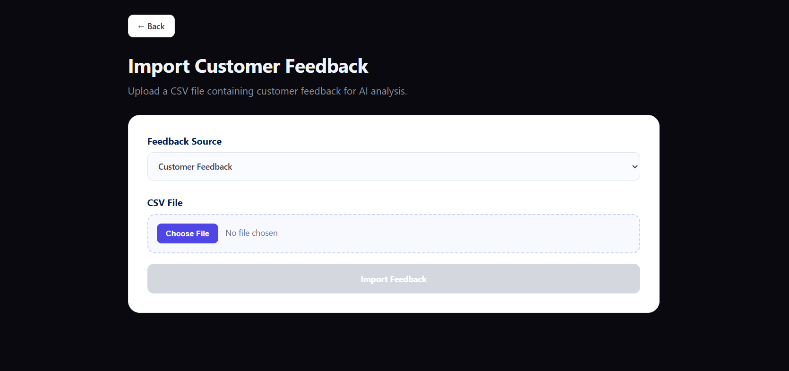
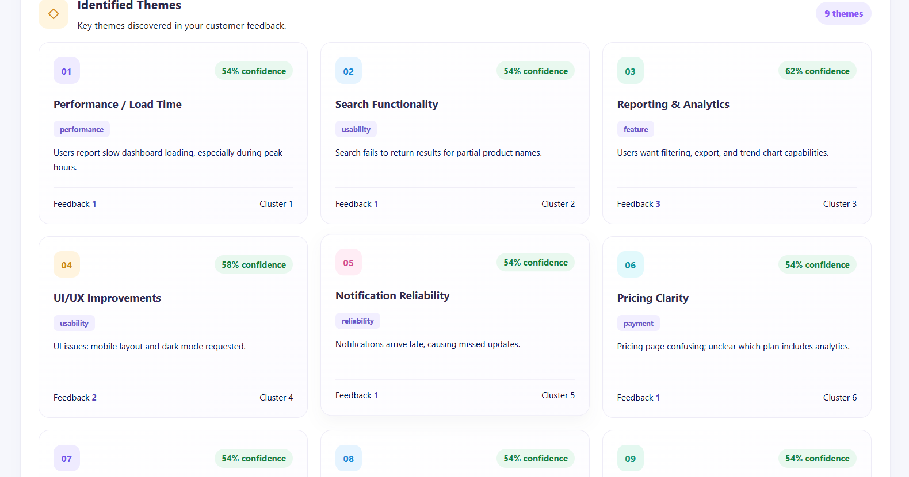
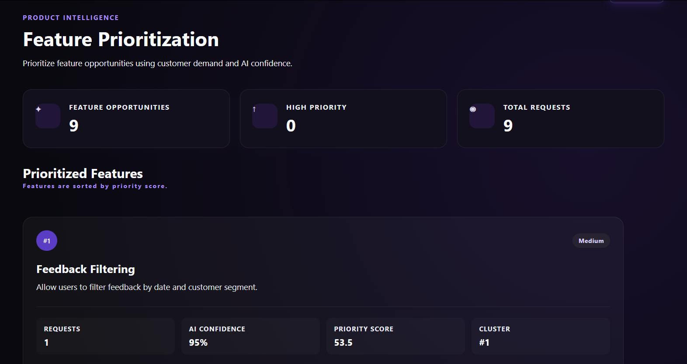
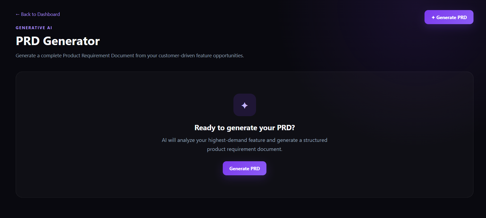
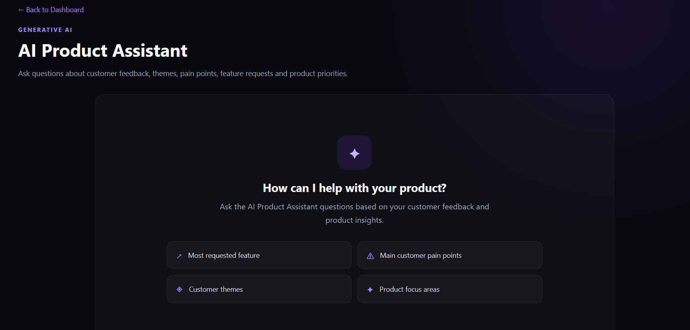
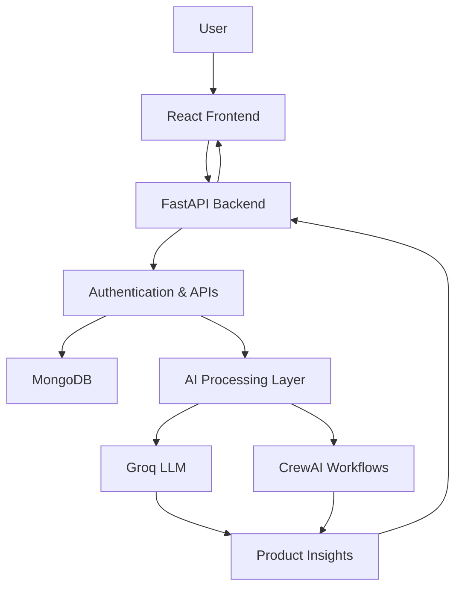

# 🚀 AI-Driven Product Assistant

### Transform Customer Feedback into Actionable Product Strategy with AI

An AI-powered product management workspace that transforms raw customer feedback into meaningful insights, prioritized feature requests, Product Requirements Documents (PRDs), and actionable product roadmaps.

Built to help product teams understand customer needs, identify pain points, and make data-driven product decisions faster.

---

## ✨ Key Features

- 🤖 **AI-Powered Feedback Analysis** – Analyze customer feedback using AI and extract meaningful insights.
- 🔍 **Theme & Pain Point Detection** – Identify recurring themes, customer frustrations, and product problems.
- 💡 **Feature Request Extraction** – Discover feature requests and improvement opportunities from feedback.
- 📈 **Feedback Trend Analysis** – Understand customer feedback patterns and emerging trends.
- 🎯 **Feature Prioritization** – Prioritize feature ideas to support product decision-making.
- 📄 **Automated PRD Generation** – Generate Product Requirements Documents from product insights.
- 🗺️ **AI-Generated Product Roadmaps** – Create structured product development roadmaps.
- 💬 **AI Product Assistant** – Interact with an AI assistant for product-related analysis and planning.
- 📊 **Executive Summary & Product Strategy** – Generate product-level summaries and strategic insights.
- 🔐 **Secure Authentication** – User registration, login, and JWT-based authentication.

---

## 🖥️ Application Screenshots

### Login



### Dashboard



### Feedback Management & Import



### AI Insights & Theme Identification



### Feature Prioritization



### PRD Generation



### AI Product Assistant



---

## 🛠️ Tech Stack

| Technology | Purpose |
|---|---|
| React.js         | Frontend user interface |
| JavaScript       | Frontend programming |
| CSS              | Styling and responsive UI |
| Python           | Backend programming |
| FastAPI          | REST API development |
| MongoDB          | Database and data storage |
| JWT              | Authentication and authorization |
| Groq API         | Large Language Model integration |
| CrewAI           | AI agent workflows |
| Swagger / OpenAPI | API documentation |
| Git & GitHub     | Version control and collaboration |
| VS Code          | Development environment |

---

## 🏗️ System Architecture



---

## 🔄 How It Works

1. **Import Feedback** – Upload customer feedback and collect product-related information.
2. **Analyze with AI** – Process feedback to identify themes, pain points, and feature requests.
3. **Discover Insights** – Explore customer problems, recurring patterns, and feedback trends.
4. **Prioritize Features** – Evaluate and organize feature requests to identify improvement opportunities.
5. **Generate Requirements** – Create structured PRDs based on product insights.
6. **Build Roadmaps** – Generate AI-assisted product development plans.
7. **Plan Product Strategy** – Use AI-generated insights to support product decisions.

---

## 🧠 AI Capabilities

The application integrates AI to support product management activities, including:

- Customer feedback theme extraction
- Customer pain point identification
- Feature request analysis
- Feedback pattern and trend analysis
- Feature prioritization assistance
- Product requirements generation
- Product roadmap generation
- Product strategy analysis
- AI-assisted product conversations

The goal is to bridge the gap between raw customer feedback and product development decisions.

---

## 📦 Application Modules

| Module | Description |
|---|---|
| Dashboard | Overview of product feedback and key insights |
| Feedback Management | Import and manage customer feedback |
| AI Insights | Discover themes, pain points, and feedback patterns |
| Feature Clusters | Analyze and organize feature requests |
| Feature Prioritization | Evaluate and prioritize product features |
| PRD Generation | Generate Product Requirements Documents |
| Product Roadmap | Create AI-assisted development roadmaps |
| AI Assistant | AI-powered product management assistance |
| Product Strategy | Generate strategic product insights and summaries |
| Reports | Access product analysis and reports |
| User Stories | Generate structured product user stories |

---

## ⚙️ Getting Started

Follow these steps to run the project locally.

### Prerequisites

Make sure you have installed:

- Python 3.11+
- Node.js and npm
- MongoDB
- Git

---

### 1️⃣ Clone the Repository

```bash
git clone https://github.com/dimple9079/ProductManagerCopilot.git
```

Navigate to the project directory:

```bash
cd ProductManagerCopilot
```

---

### 2️⃣ Backend Setup

Create a virtual environment:

```bash
python -m venv .venv
```

Activate it on Windows:

```powershell
.\.venv\Scripts\Activate.ps1
```

Install the backend dependencies:

```bash
pip install -r requirements.txt
```

Configure your environment variables according to the backend configuration. This includes the required MongoDB connection settings, authentication settings, and Groq API key.

Example:

```env
GROQ_API_KEY=your_groq_api_key
```

> Keep your actual API keys and credentials private. Never commit your `.env` file.

Start the backend server from the project root:

```powershell
.\.venv\Scripts\python.exe -m uvicorn app.main:app --reload --port 8000 --app-dir backend
```

Backend will run at:

```text
http://127.0.0.1:8000
```

### API Documentation

FastAPI automatically provides interactive API documentation.

Swagger UI:

```text
http://127.0.0.1:8000/docs
```

OpenAPI documentation:

```text
http://127.0.0.1:8000/openapi.json
```

---

### 3️⃣ Frontend Setup

Open a new terminal from the project root.

Navigate to the frontend directory:

```bash
cd frontend
```

Install dependencies:

```bash
npm install
```

Start the development server:

```bash
npm run dev
```

Open the local URL displayed in the terminal by Vite to access the application.

---

## 🔐 Security

- Authentication using JWT
- Environment-based configuration for sensitive credentials
- Secret files excluded from version control
- Backend API-based data access
- Workspace-based product management

> Security configurations should be reviewed and appropriately strengthened before production deployment.

---

## 📁 Project Structure

```text
ProductManagerCopilot/
│
├── ai/
│   └── AI processing and agent workflows
│
├── backend/
│   └── app/
│       ├── main.py
│       ├── routes/
│       ├── services/
│       └── ...
│
├── frontend/
│   ├── src/
│   ├── public/
│   └── ...
│
├── docs/
│   └── screenshots/
│       ├── login.png
│       ├── dashboard.png
│       ├── import-feedback.png
│       ├── ai-insights.png
│       ├── feature-prioritization.png
│       ├── prd-generator.png
│       └── ai-assistant.png
│
├── requirements.txt
├── .gitignore
└── README.md
```

---

## 🎯 Project Objective

ProductManagerCopilot aims to simplify product management by converting unstructured customer feedback into structured insights, actionable feature requirements, and AI-assisted product planning.

It helps product teams better understand users, identify important product improvements, and make informed product development decisions using AI.